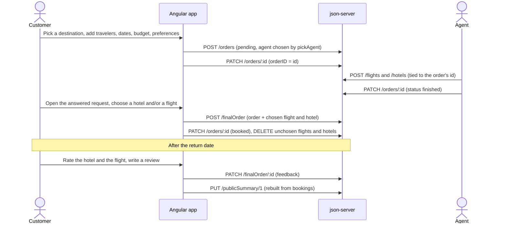
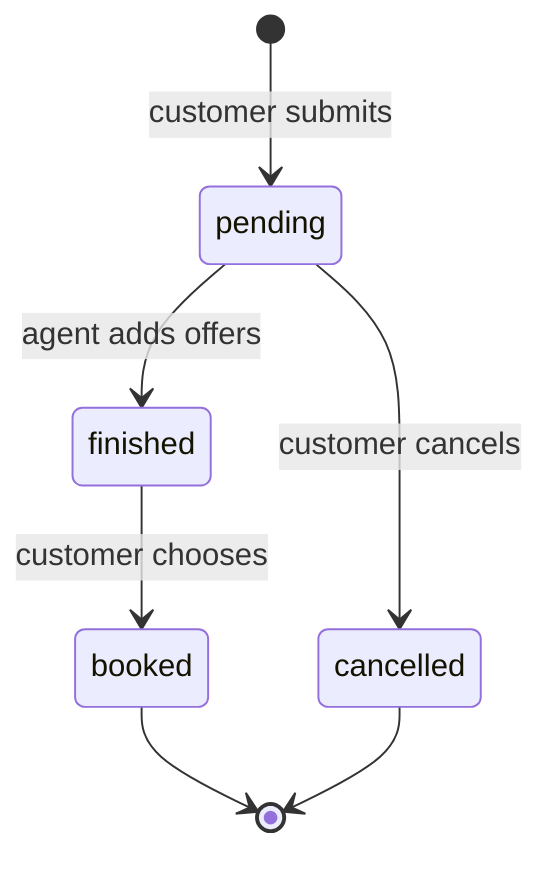

# Application flow

Who can do what, and how a request moves from a customer's booking form to a rated trip. Structure and design
decisions are in [architecture.md](architecture.md).

## Contents

[Roles](#roles) · [A request from start to finish](#a-request-from-start-to-finish) ·
[Assignment](#assignment) · [Order statuses](#order-statuses) · [Visitors and destinations](#visitors-and-destinations) ·
[Validation and error handling](#validation-and-error-handling)

## Roles

| Role | Can do |
|---|---|
| Visitor (`unknown`) | Information only: how it works, trending destinations (each opens a panel with facts, real numbers and reviews), the agents, the airlines, live service numbers, reviews, a FAQ and a question form. Choosing a destination leads to sign-in and, for a customer, to a booking form with it selected. No booking on the page itself |
| Customer | A dashboard with a photo hero, their open orders with a step progress bar and a Confirm booking button, their agent (rating, languages, answer time) and trending destinations. `/homepage/book`, `/homepage/bookings` (opens on "Ready to choose", with upcoming tickets and a past-trips list on the Booked tab) and `/homepage/messages` are real routes. Books a trip in four steps (destination, travelers, details, preferences), lands on a status page with their assigned agent, a timeline, what happens next, messages, and can edit or cancel while the request waits; chooses among the agent's hotels and flights; rates a finished trip. Messages are kept per request, so the messages page asks which request to write about |
| Agent | Works through their own queue of pending requests (with the customer's wishes beside every field), chooses airline, flight and hotel details, messages the customer, switches availability, and reads their own statistics on the Insights tab |
| Admin | One long page: company-wide numbers and an agent comparison, every request with manual reassignment, agents and their accounts, airlines, a configuration editor, visitor inquiries, review moderation and an audit log |

The route that loads at `/homepage` depends on the signed-in user's role.

## A request from start to finish

1. A customer registers and logs in. The `''` homepage route resolves to the customer dashboard; "Book your trip" and
   "Manage bookings" open `/homepage/book` and `/homepage/bookings`, and "Message <agent>" opens `/homepage/messages`
   to pick the request. Logging in with a destination chosen on the visitor homepage goes straight to
   `/homepage/book`.
2. The customer files a request (`user-requests`), which creates a `pending` order. The backend assigns the number.
3. An agent logs in, opens the order from the order list, and adds a flight (`my-flights`) and a hotel (`my-hotels`)
   tied to that order's id. The form warns, without blocking, when an offer differs from what the customer asked for.
4. The agent marks the order finished (`updateStatusByOrderID`).
5. The customer opens the answered request (`final-order`) and picks a hotel and/or a flight. That combines the order,
   flight and hotel into a `finalOrder` record (the customer's booking), marks the order `booked` (it is kept, so its
   number is never handed out again) and deletes the redundant flight and hotel records.
6. Once the return date has passed, the customer rates the booking; the rating is stored as `feedback` on the
   `finalOrder` record and feeds the agent's Insights and the public summary.

## Assignment

Each request is assigned to an agent automatically when it is created (`pickAgent`): the agent with the fewest open
requests, with a head start for a specialist in the destination or the trip type, skipping agents who are away.
Specialties are free text and are matched to the destination by name.

A request nobody answers within the promised time (24 hours by default, set in the admin configuration) is handed to
another agent once, and the customer is told. An agent who goes away has their pending requests handed on. Every
assignment is recorded on the order (`assignments`).

## Order statuses

`OrderStore` holds every order except booked ones; booked trips are read through `BookingStore`, and a booking only
counts when no open request has the same number.

## Visitors and destinations

A visitor can open a destination panel on the homepage. Its sign-in and register links carry `?destination=<id>`; the
login and register pages show which trip the visitor is signing in for, and after login the customer lands on
`/homepage/book` with that destination selected. An id that is not one of the destinations we offer is ignored.

## Validation and error handling

- Forms use Angular reactive forms with validators (required, patterns for names, countries and `HH:MM` times, length
  limits for IDs and prices). The flight form requires a stop duration only when the flight has a stop. A form's primary
  button is disabled while the form is invalid, and field errors show once a field has been touched.
- `HttpResourceService` logs backend failures and rethrows a user-facing message; `SessionStore.siteLogin` turns an HTTP
  error into a failed login rather than throwing.
- Invalid login shows an inline message; success and failure of agent actions use snack bars.
- **Booking form:** the departure cannot be in the past, the return not before the departure, the budget must be above
  0, the origin and names must not be blank, IDs must be positive (travelers' Israeli ID check digit, first and last
  name, no duplicates), a destination must be picked from the ones we offer and the origin (a known country or city,
  with autocomplete) must differ from it. Values are trimmed before they are sent. The form also collects the
  customer's **preferences** (stops or direct, checked baggage, cabin, departure time, preferred airlines, flexible
  dates, hotel breakfast, bed, area, rooms, meals, seat, assistance, notes) for the agent.
- **Ratings:** each booked part needs a whole number from 1 to 5, the review is trimmed and limited to 500 characters,
  and `BookingStore.rate` refuses other customers' bookings and trips that have not ended.
- **Statistics read data defensively:** `computeInsights` skips records with missing orders, ratings outside 1 to 5,
  negative prices or unreadable dates, and the tab says how many bookings were left out.
- **Admin forms** check agent profiles and airlines with the same rules the save uses (`validateAgentProfile`,
  `validateConfig`), so the form and the save cannot disagree.
